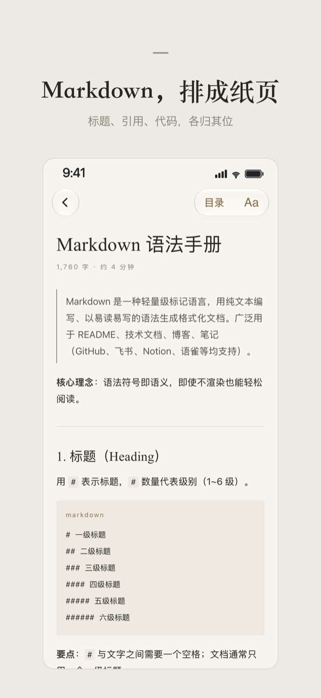

# SuJian (素笺)

**English** | [简体中文](README.zh-CN.md)

<p align="center">
  <a href="https://apps.apple.com/app/id6820091612">
    
  </a>
</p>

<p align="center">
  
</p>

SuJian is a Markdown and plain-text reader for iPhone and iPad. It supports opening documents from Files, browsing an app folder, following document links, and restoring reading positions.

SuJian opens Markdown from Files and typesets it as a calm, paper-like page for reading.

## Features

- Open `.md` and plain-text files from Files or the Share sheet, or drop them into the app's folder.
- Paper-style rendering of headings, tables, code blocks, footnotes, and callouts.
- Table of contents, in-document anchors, and links between local documents.
- A library with recent documents and search; reading position and text size are remembered.
- No analytics or tracking; the app makes no network requests of its own (web images referenced by a document may load).

This repository is a source snapshot of the SuJian app. It includes a separate Xcode project and placeholder app icon; its version number does not represent an App Store release.

## Requirements

- Xcode 27.2 (the version used to prepare this snapshot) and an iOS simulator.
- iOS 26 or later.
- Network access on first build to resolve the Swift Package dependencies. `Package.resolved` records the versions used by the project.

## Build and test

Open `SuJian.xcodeproj`, choose the **SuJian** scheme, and run on an iPhone or iPad simulator. To run the unit and UI tests, choose Product → Test. From a terminal, for example:

```sh
xcodebuild test -project SuJian.xcodeproj -scheme SuJian \
  -destination 'platform=iOS Simulator,name=iPhone 17'
```

Choose an installed simulator from `xcodebuild -showdestinations -project SuJian.xcodeproj -scheme SuJian` if that device is unavailable. UI tests use temporary documents and an in-memory library. Some layout tests are intended for particular device sizes and may skip on other simulators.

To run on a physical device, choose your own development team in Signing & Capabilities and change the app and test bundle identifiers as needed. No signing credentials are included.

## Source and updates

This repository contains an open-source snapshot of the app and has its own Git history.

The application source and both test targets are included. Localized strings, asset colors, document type configuration, and the Swift package lockfile are retained because the project needs them. UI tests generate their own fixture documents. The app icon is an empty Xcode placeholder and is not the distribution icon.

The project depends on [swift-markdown](https://github.com/swiftlang/swift-markdown) and its transitive dependency swift-cmark. Their own licenses apply to those dependencies.

## License

The source in this repository is available under the [MIT License](LICENSE). Third-party dependencies are licensed separately.
