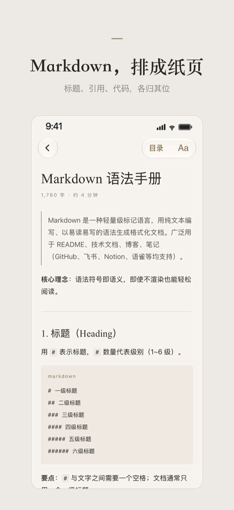

# 素笺（SuJian）

[English](README.md) | **简体中文**

<p align="center">
  <a href="https://apps.apple.com/app/id6820091612">
    
  </a>
</p>

<p align="center">
  
</p>

素笺是一款适用于 iPhone 和 iPad 的 Markdown 与纯文本阅读器。支持从「文件」打开文稿、浏览 App 文件夹、跟随文稿内的链接，以及恢复阅读位置。

素笺把「文件」里的 Markdown 排成安静的纸页来读。

## 功能

- 从「文件」或分享面板打开 `.md` 和纯文本文件，也可以直接放进 App 的文件夹。
- 纸页风格排版：标题、表格、代码块、脚注和提示块（callout）。
- 目录、文内锚点跳转，以及本地文稿之间的链接。
- 文库：最近阅读与搜索；记住阅读位置和字号。
- 没有统计或追踪；App 自身不发起网络请求（文稿中引用的网络图片可能会加载）。

本仓库是素笺 App 的源码快照，使用独立的 Xcode 工程和占位 App 图标；其中的版本号不代表 App Store 版本。

## 环境要求

- Xcode 27.2（准备本快照时使用的版本）和 iOS 模拟器。
- iOS 26 或更高版本。
- 首次构建需要联网以解析 Swift Package 依赖，`Package.resolved` 记录了工程使用的版本。

## 构建与测试

打开 `SuJian.xcodeproj`，选择 **SuJian** scheme，在 iPhone 或 iPad 模拟器上运行。运行单元测试和 UI 测试请选择 Product → Test。也可以在终端执行，例如：

```sh
xcodebuild test -project SuJian.xcodeproj -scheme SuJian \
  -destination 'platform=iOS Simulator,name=iPhone 17'
```

如果没有该设备，可通过 `xcodebuild -showdestinations -project SuJian.xcodeproj -scheme SuJian` 选择已安装的模拟器。UI 测试使用临时文稿和内存中的文库。部分布局测试只针对特定设备尺寸，在其他模拟器上可能会跳过。

如需在真机上运行，请在 Signing & Capabilities 中选择你自己的开发团队，并按需修改 App 和测试的 bundle identifier。仓库不包含任何签名凭据。

## 源码与更新

本仓库是 App 的开源快照，拥有独立的 Git 历史。

仓库包含 App 源码和两个测试 target。本地化字符串、颜色资源、文档类型配置和 Swift Package 锁定文件因工程需要而保留。UI 测试会自行生成测试文稿。App 图标是 Xcode 的空占位，并非发布版图标。

本工程依赖 [swift-markdown](https://github.com/swiftlang/swift-markdown) 及其间接依赖 swift-cmark，它们各自的许可证适用。

## 许可证

本仓库源码以 [MIT 许可证](LICENSE) 发布。第三方依赖另行授权。
